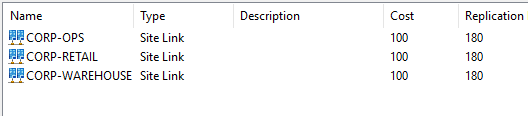
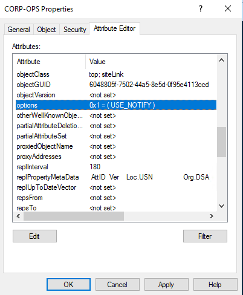
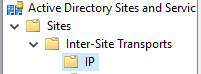
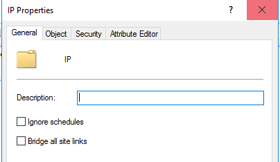
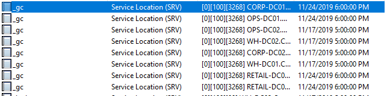
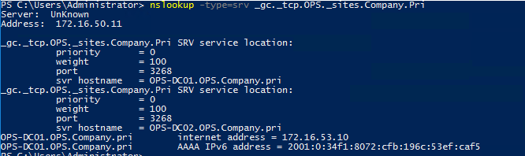
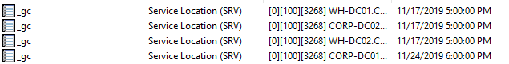

Over the past year, I have been in a number of conversations about setting up Active Directory Sites and Services in a network that is not fully routed. Articles exist on the subject — some from Microsoft and some not. All the articles seem to skip a step or don’t linger on a detail I’d like to expand on.

The question of “How do I configure Active Directory in a non-routed environment?” isn’t uncommon. With more organizations segmenting out their networks, with more B2B contracts encouraging companies to play well with one another, or whatever the need to ensure that AD plays across confusing site designs is imperative.

Fortunately, there resources and articles out that detailing just this sort of thing. Unfortunately, like all things, they are often incomplete or gloss over an important step. Even more unfortunate, with Microsoft’s recent drive to remove “outdated” documentation some of the gems of the past have gone missing. I hope to give some insight into how to configure AD to work with non-routed or poorly routed networks. I will focus on the Sites and Services side and give some guidance on the GPOs, firewall policies, and as many details that make sense as I dig into it.

<!-- more -->

## Lab Setup

have a CORP domain with two sites, CORP and WAREHOUSE (WH), and two child domains spun off of the CORP parent, RETAIL and OPS. RETAIL and OPS need to be segregated from each other and from WAREHOUSE. Everyone needs to be able to talk back and forth with the CORP site.

Each site has its own subnet in my design. The subnets are routed in my lab since that is how my lab is setup. Rather than breaking the routes I’m using Windows Firewall to block MS-RPC and LDAP traffic between the sites and warehouse.

Another thing worth mentioning is I disabled Bridge All Site Links (BASL) and changed how DCs create SRV records. I’ll explain why I did this below but understand that it is a crucial part to how this whole thing is architected.

Last, the specific details about the lab (number of DCs, DC hardware, etc.) are left out. It shouldn’t matter in this step. All that matters is that every site has a DC and every DC has a site.

### Disclaimer #1 – Proper Site Design

I’ve looked at a lot of environments and worked with a lot of admins trying to make their AD work like a charm. One of the most neglected, yet critical, pieces of a proper AD setup is the Site and Services configuration. This is even more prevalent in medium-sized organizations and larger as they tend to have more sites and thus more complexity. Admins tend to setup AD Sites and Services with the out-of-the-box defaults and it just works. Why change it? Or, they don’t understand it enough to change it with confidence.

For a non-routed AD topology to work, your Sites and Services must be solid. If it isn’t there will be issues. Map your subnets to their sites, ensure that proper sites are configured, make sure that ever site has a DC, etc. These are all import. However, you must understand your network topology appropriately and make sure that that topology is correctly mirrored in AD Sites and Services (within reason).

### Testing it All Before Breaking it All

Before breaking an environment it is important to know that said environment works. I want my directory full converged with all DCs having successful replications and a DNS that resolves as I would expect.

I ran the following checks on every DC to verify everything worked. If these come back without errors it is likely all things are peachy.

```
dcdiag
Repadmin /showrepl /errorsonly
Repadmin /replsum
Nltest /dsgetdc:
Nltest /dsgetdc: /avoidself
Nltest /dsgetdc:company.pri
Nltest /dsgetdc:retail.company.pri
Nltest /dsgetdc:ops.company.pri
```

### Sites and Services Setup

Each of the sites I mentioned above were created with their own /24 subnet. Site Links were created back to the CORP site. To make sure replication worked as I expected, I wanted to make sure that each site link has both a low cost and have a short replication interval. I also went through and configured change notification on each site link.

The default cost is 100 and the default replication interval is 180 minutes. That is fine, but I like to change those  numbers. Three hours for convergence with just one set of links is not fast enough for my setup. Remember that site link costs are cumulative. Assuming for a moment that I wanted WAREHOUSE to replicate something with RETAIL they have to cross between CORP to do that. This means that with a replication period of 180 minutes for each site link it could take a total of 360 minutes for the change in WAREHOUSE to get to RETAIL. Let’s change the defaults. Change notification gets around some of this but we want the replication costs set right. Some stuff will always use that even with notify turned on.



Altering the cost and replication interval of the site links is very straight forward. I’ll set the cost to 50 and the interval to the lowest possible value: 15. I’ll be using PowerShell to do this, it is a one-and-done method that has a lot fewer clicks.

```
Get-ADReplicationSiteLink -Filter * | Set-ADReplicationSiteLink -Cost 50 -ReplicationFrequencyInMinutes 15
```

The above command first grabs all the Site Links in the forest (remember Sites and Services is a forest-wide part of AD). I then send those to Set-ADReplicationSiteLink and alter the cost and the replication frequency.

Next, it is time to enable change notification on the site links. Within a site change notification is the default. Changing site links to behave the same way effectively makes the DCs all act as if they are in one site, even though great distances may be between them. This all means that the DCs in all my sites will converge very quickly, likely under a minute.

Change Notification tells domain controllers to notify replication partners immediately upon receiving a change. If I add a user to a new group, in this scenario, the DC would notify its partners immediately that the change happened and then they would request the change be replicated. Without change notification the DCs store up changes and send all the data as a big chunk of replication traffic at every replication interval. Rather than communicating larger pieces of information periodically change notification communicates with a frequent, but small, series of notifications about changes.

I changed change notification because Microsoft has been recommending it for most environments for years. Smaller environments may not even need it as they are unlikely to have multiple sites. Medium and larger environments could benefit from it assuming their sites are well-connected.

### DISCLAIMER #2 – Risks of Change Notify

First, DCs are more chatty. They send little pieces of information rather than large pieces. Bandwidth-wise this shouldn’t matter all that much but I have seen cases where it wasn’t an ideal setup.

Second, if you have already configured options on your site link (you will know if you have) if you blindly follow my steps you can blow away what you currently have which may not be ideal. The options field uses bitmasks. If you have any concerns about blowing something away, check the References section below for some notes and do some of your own research beforehand.

Finally, another risk of change notify is speed of changes. In a standard replication model, if I were to change the group membership of a user it would queue up that change and send it during the replication interval later. If I were to change that user’s group membership a second time before the interval hit, both changes go through. If that second change were to remove the user from the group I had just added them to, only the second changes goes through as AD would only send what was relevant. Change notification will make it where each change along the course of work will be near immediately replicated. So your mistakes may become environment-wide mistakes faster with change notification on. This is a minor risk as most changes are rather non-impacting on their own, but keep all that in mind as you go forward.



#### Configuring Change Notification

##### Manual Method

1. Right-Click the Site Link \ Properties
2. Attribute Editor Tab
3. Locate the Options Attribute
4. Edit “Options”
5. Set the value to “1”
6. Options should now show “0x1 = (USE_NOTIFY)”

##### PowerShell Method

```
Get-ADReplicationSiteLink -Filter * | Set-ADReplicationSiteLink -Add @{"options"=1}
```

In the Powershell method I set it for every site link at once. I also hope you noticed there isn’t a -UseNotify or -Options switch on the command. Microsoft decided to make this command a little complicated. Fortunately, the -Add switch and its kindred allows us to do just about whatever we need to the attributes on this object type.

### Disclaimer #3 – Why Are You Not Routing Your Sites?

We are now ready to start creating a non-routed site and services topology. But first, I want to ask the question: **Why are you not routing your sites?**

A lot of organizations I’ve worked with do this because of “security” reasons. Tenant A shouldn’t be able to talk to Tenant B. If that is the case, while this design accomplishes that goal the best practice is to create separate forests. AD assumes all sites and domains in a forest can talk with one another, at least to some degree. If you break those sites or domains off into their own forests, there is no assumption of communication. I know there are some administrative hurdles there but those are not something that can’t be dealt with.

I’m not saying that you are chosing a bad design, I’m simply asking that you consider moving forward cautiously. Make sure you understand why you want to do this and that it makes the best sense for your environment. There is rule of thumb with AD, even a blog post about it from Microsoft: You are not smarter than the KCC. So let it do what it does.

[https://docs.microsoft.com/en-us/archive/blogs/markmoro/you-are-not-smarter-than-the-kcc](https://docs.microsoft.com/en-us/archive/blogs/markmoro/you-are-not-smarter-than-the-kcc)

Okay, that is my final warning before we start doing this.

## Creating a Non-Routed Site Design

As I said before, rather than configuring my Vyos lab router to not route between my /24 links, I decided to use the Windows Defender Firewall to block LDAP 389 and the RPC Dynamic Port Range (49152 – 65535) for each domain. I only blocked it inbound on the other domains controllers. I have more details on this and some its challenges in the “Dig Deeper” section at the end of this post.

This method is not the recommended way to firewall off sites and I only did it out of convenience. If you wanted to do this in production, work with your network team and properly route/firewall your network.

### Disabling Bridge All Site Links

By default Active Directory bridges all site links together. This allows every site to have a “direct” connection with every other site which means AD will create connections between sitelinks to create a intersite mesh topology of sorts. It also ensure that replication can go in virtually any direction. Remember the goal of the ISTG and KCC in this case to ensure the topology that achieves convergence as quickly as possible.

In a normal environment, Bridge All Site Links (BASL) should be left on. It works and most environments don’t do anything weird with their sites like this. That being said, Microsoft does have two scenarios where they recommend disabling BASL: 1) the network is not fully routed and 2) you need to control the flow of replication manually. Generally, you have the second scenario because of the first or you have an enormous environment that doesn’t allow for natural replication paths.

[https://docs.microsoft.com/en-us/windows-server/identity/ad-ds/plan/creating-a-site-link-bridge-design](https://docs.microsoft.com/en-us/windows-server/identity/ad-ds/plan/creating-a-site-link-bridge-design)

Obviously, I’m doing it because our sites aren’t intended to communicate. Why create links that won’t work anyway. So let’s just turn it off. If for some reason you were relying on Bridge All Site Links for something, you can simply setup a manual site link bridge between those site links.



1. Login to one of the root domain controllers
2. Launch AD Sites and Services
3. Expand Sites
4. Expand “Inter-Site Transports”
5. Right-Click “IP” \ Choose “Properties”
6. On the General Tab \ Uncheck “Bridge all site links”



#### Disabled via Powershell

```
$ConfigDN = (Get-ADRootDSE).configurationNamingContext
Set-ADObject -Identity "CN=IP,CN=Inter-Site Transports,CN=Sites,$ConfigDN" -Replace @{"options"=2}
```

According to the Open Protocol Information put out by Microsoft, there are only two options that can be configured on the Inter-Site Transports containers (IP or SMTP): Ignore Schedules and Bridge All Site Links. I think the likelihood of running into a scenario where the -Replace option for Powershell overwriting an existing option is remote. If you are concerned, use Get-ADObject to confirm your current configuration and adjust accordingly. See the below link to see the different options for the IP Container.

[https://docs.microsoft.com/en-us/openspecs/windows_protocols/ms-adts/66db6a63-52d2-4980-b87b-7b2d598dba81](https://docs.microsoft.com/en-us/openspecs/windows_protocols/ms-adts/66db6a63-52d2-4980-b87b-7b2d598dba81)

### Changing How AD SRV Records are Registered

Normally, AD does some cool stuff with SRV record registration. Specifically, DCs will log and respond to generic SRV records created in the root domain of a forest to help locate global catalogs services such as LDAP and Kerberos, among other things. These generic records act as fallback records if a site loses its DCs for whatever reason. A client will simply find a random DC to talk to so communication stays up.

Since we’ve firewalled off our different sites, I  don’t want a bunch of site records in the root of the domain that just go anywhere. I want only the root DC records in the root and the specific sub-domain DC records in their specific domains. The root will be able to handle if something goes wrong with the site but not another domain.

Let’s look at the defaults and then decide what to do.

1. Launch DNS Management (dnsmgmt.msc)
2. Expand Forward Lookup Zones
3. Expand your root domain name
4. Click on _tcp
5. Specifically we are looking at the _gc records



Notice how we have a GC record for every domain controller in the domain. AD logs a record for each GC, and other records, in a generic record to help with DC Locator. First a client will try to locate a DC in its site and if that fails it passes up to the root “generic” records and receives a random entry that can be any domain controller in the domain or forest.

You can view the site entries with the following nslookup query to return GCs only in the OPS site.

```
nslookup -type=srv _gc._tcp.OPS._sites.company.pri
```



So the scenario we are looking at is that if a client looks for a GC in its site, either of the OPS DCs can respond. That is what we want. However, if a DC in the OPS site cannot respond or doesn’t respond fast enough, DC Locator may step up and try to do a generic query to _gc._tcp.Company.Pri. That query can return any DC in the forest. If had blocked 3268/3269 or any communication is lost between my host and these DCs, how are GC queries supposed to work? It could possibly sit there and loop through the list of GCs until it finds a server it can talk to or it times out (55 hops).

Never fear! There is a solution to this problem. We need to create a Group Policy. Actually, we need several.

**==DO NOT LINK THIS POLICY IN THE ROOT SITE/DOMAIN!!!==**

1. Launch Group Policy Management Editor
2. Create a new policy called “DC DNS Registration” or something similar.
3. Edit the new policy.
4. Browse to “Computer Configuration \ Policies \ Administrative Templates \ System \ Net Logon \ DC Locator”
5. Double Click the setting “Specify DC Locator DNS records not registered by the DCs”
6. Specify the following values (I will cover these in the Digging Deeper section later).  
    `DC DcByGuid Gc GcIpAddress GenericGC Kdc Ldap LdapIpAddress Rfc1510UpdKdc Rfc1510Kpwd Rfc1510UpdKdc Rfc1510UdpKpwd`
7. Close out the group policy editor and save the policy
8. In GPMC Right-Click “Domains” \ Choose “Show Domains”
9. Choose one of the other child domains (**Note:** this must be done in the root if you killed 389)
10. Right-Click the “DC DNS Registration” policy \ Choose “Copy”
11. Navigate to one of the other child domains in GPMC \ Expand “Group Policy Objects”
12. Right Click “Group Policy Objects” \ Choose “Paste”
13. Next through the prompts to copy the policy
14. Link the policy to the Domain Controllers OU in the child domains.  
    **NOTE:** For the love of all that is holy, please test the policy before going nuts and linking it in prod. If you brick your prod, it isn’t my fault!
15. Login to one of the child DCs and run gpupdate /force. I also suggest rebooting
16. Repeat this process for other child domains.

You may not have to reboot – most administrative template GPOs are real-time and take effect immediately without reboot. However, with computer policies its hard to predict. We also need the Netlogon service to restart as that will remove the old DNS records (assuming Dynamic DNS Registration is turned on).

When the server comes back up, login and check your records. You may need to bounce Netlogon a couple of times and do an ipconfig /registerdns to clear the old records. Ultimately, if the records don’t go away you can delete them manually out of DNS and they should not re-register.



You can see that the list got smaller with those records removed. Now if a GC in the local site cannot be resolved, we head up to the root for help instead of finding a random server in some random site/domain. I ran through my checks and everything looked healthy so this worked. You may receive some errors with nltest looking cross domains as those domains cannot talk and you will receive errors in the `repadmin /replsum` since the environment isn’t fully routed.

## Conclusion

I hope this helped you out! Send me a message or leave a comment if you have questions or if there is something else you’d like me to cover. As always, test in non-prod or test environments before implementing any of this in production. See the below sections for references I used and some deeper dives into a couple of areas.

## References

Site Link Bridge Design  
[https://docs.microsoft.com/en-us/windows-server/identity/ad-ds/plan/creating-a-site-link-bridge-design](https://docs.microsoft.com/en-us/windows-server/identity/ad-ds/plan/creating-a-site-link-bridge-design)

Enable or Disable Site Link Bridges  
[https://docs.microsoft.com/en-us/previous-versions/windows/it-pro/windows-server-2003/cc738789(v=ws.10)](https://docs.microsoft.com/en-us/previous-versions/windows/it-pro/windows-server-2003/cc738789\(v=ws.10\))

Preventing Spoke DCs from Advertising in the Hub for Authentication and Availability  
[https://support.microsoft.com/en-us/help/816587/how-to-verify-that-srv-dns-records-have-been-created-for-a-domain-cont](https://support.microsoft.com/en-us/help/816587/how-to-verify-that-srv-dns-records-have-been-created-for-a-domain-cont)

How to verify that SRV DNS Records have been created for a DC  
[https://support.microsoft.com/en-us/help/816587/how-to-verify-that-srv-dns-records-have-been-created-for-a-domain-cont](https://support.microsoft.com/en-us/help/816587/how-to-verify-that-srv-dns-records-have-been-created-for-a-domain-cont)

Optimize Location of a DC or GC  
[https://support.microsoft.com/en-us/help/306602/how-to-optimize-the-location-of-a-domain-controller-or-global-catalog](https://support.microsoft.com/en-us/help/306602/how-to-optimize-the-location-of-a-domain-controller-or-global-catalog)

IP Container Bitmasks  
[https://docs.microsoft.com/en-us/openspecs/windows_protocols/ms-adts/66db6a63-52d2-4980-b87b-7b2d598dba81](https://docs.microsoft.com/en-us/openspecs/windows_protocols/ms-adts/66db6a63-52d2-4980-b87b-7b2d598dba81)

AD Firewall Stuff  
[https://support.microsoft.com/en-us/help/179442/how-to-configure-a-firewall-for-domains-and-trusts](https://support.microsoft.com/en-us/help/179442/how-to-configure-a-firewall-for-domains-and-trusts)

Change Notification and You  
[https://blogs.msdn.microsoft.com/canberrapfe/2012/03/25/active-directory-replication-change-notification-you/](https://blogs.msdn.microsoft.com/canberrapfe/2012/03/25/active-directory-replication-change-notification-you/)

You are not smarter than the KCC

[https://blogs.technet.microsoft.com/markmoro/2011/08/05/you-are-not-smarter-than-the-kcc/](https://blogs.technet.microsoft.com/markmoro/2011/08/05/you-are-not-smarter-than-the-kcc/)

## Digging Deeper

### Windows Firewall Configuration to Lock Down Child Domains

As I mentioned above, I used Windows Firewall to lock down my sites and domains to prevent communication. Here are the settings I used and some reasoning behind my choices. I would not advise blocking 389 as it really screws with some management functions and can slow down AD (though in production you should be using 636 anyway). To block replication you should focus on the RPC Dynamic Range. You would probably want to do more blocks and more restrictions if you wanted to actually block two child domains.

Ultimately, I would recommend doing these configurations with hardware firewalls and the like. This isn’t really a sound use-case for Windows Firewall.

==**NOTE:** DO NOT LINK THIS POLICY IN THE ROOT DOMAIN!!==

1. Launch Group Policy Management Center
2. Expand Domains \ Select the domain that you wish to create the policy in
3. Right-Click “Group Policy Objects” \ New
4. Name the policy
5. Right-Click the new policy \ Edit
6. Navigate to “Computer Configuration \ Policies \ Windows Settings \ Security Settings”
7. Expand “Windows Firewall with Advanced Security”
8. Expand “Windows Firewall with Advanced Security” (Firewall Icon)
9. Click “Inbound Rule”
10. Right-Click “New Rule”
11. Choose Port
12. Leave TCP Selected
13. Configure the following ports: 389, 49152-65535
14. Choose to “Block the connection”
15. Leave all profiles selected
16. Name the firewall rule (e.g. Block TCP 389, 49152-65535)
17. Find the rule you just created \ Right-Click the rule \ Properties
18. Click the “Scope” tab
19. Select “These IPs under Remote IP Address”
20. Add the different IPs of of the DCs you DO NOT want to talk to the DC this rule applies to.
21. Click OK
22. Repeate 10 – 21 except configuring UDP instead of TCP.
23. Repeat this process again for each domain you wish to lock down making sure to configure the correct IPs in the scope section.  
    DO NOT DO THIS IN THE ROOT DOMAIN
24. Link the policies where appropriate.

If you have separate sites in your root domain that you would like to lock down you’ll need to use Security Filtering with Group Policy to target the DCs that you wish to restrict. I would avoid using site policies, even though this seems like a use case, as they don’t always behave as you would expect and most admins don’t know to check for or pay attention to them.

If you wish to get more specific about what is being blocked, you can narrow down which ports are used for AD to a very granular level. See the “More Information” section and the “Windows Server 2008 and later versions” section for the latest and greatest port list in the below link.

[https://support.microsoft.com/en-us/help/179442/how-to-configure-a-firewall-for-domains-and-trusts](https://support.microsoft.com/en-us/help/179442/how-to-configure-a-firewall-for-domains-and-trusts)

### Site Links vs Site Link Bridges

I’m not going to lie to you. I honestly see no real use case for a Site Link Bridge. In my opinion Site Links cover the same topic and work fine. However, Microsoft has them so let’s take a minute to talk about them.

First, some definitions.

**Site Links** are objects that represent logical paths that the KCC uses to establish connections for Active Directory replication. Sites contained within a site link use the same network cost to communicate through the specified inter-site transport (IP. SMTP is a relic of the past). Any sites in a site link are said to be connected by the means of the same network type. They are not intended to mirror actual network paths so redundant links is superfluous. When a site link is created between two sites, the KCC/ISTG automatically creates connections between DCs in each site via Bridgehead servers.

**Site Link Bridges** are similar, they represent a set of site links that can communicate using the same transport. Bridges are used represent more indirect connections. The replication traffic will likely have to traverse more complicated routes to get from one site to another. The default is for the KCC to assume transitivity between all site links and thus create bridges in its own topology. The KCC will use any combination of included site links to establish the least expensive route to interconnect the domain controllers. The KCC adds up the cost of each additional site link and uses that sum for the bridged path’s cost.

Basically it breaks down to this: Site Links are for direct connections that would be physically adjacent networks and Site Link Bridges are used to connect networks that are not directly connected and must communicate via an intermediary.

[https://docs.microsoft.com/en-us/windows-server/identity/ad-ds/get-started/replication/active-directory-replication-concepts#BKMK_6](https://docs.microsoft.com/en-us/windows-server/identity/ad-ds/get-started/replication/active-directory-replication-concepts#BKMK_6)

### GPO Settings Overview

Above we configured the Net Logon group policy to skip over specific records when Netlogon dynamically registers records. I blindly gave a list without much information about the list and promised I would cover it more detail.

Here is the list of settings I chose:

- DC
- DcByGuid
- Gc
- GcIpAddress
- GenericGC
- Kdc
- Ldap
- LdapIpAddress
- Rfc1510UpdKdc
- Rfc1510Kpwd
- Rfc1510UpdKdc
- Rfc1510UdpKpwd
- Rfc1510UpdKdc

If you look at the policy setting itself, it gives us a list of what these settings do, except it is terribly hard to read. I copied the list out and formatted it for easier reading. I have bolded the one’s we are using.

|GPO Setting|Record Type|Record FQDN|
|---|---|---|
|**LdapIpAddress**|**A**|**<DnsDomainName>**|
|**Ldap**|**SRV**|**_ldap._tcp.<DnsDomainName>**|
|LdapAtSite|SRV|_ldap._tcp.<SiteName>._sites.<DnsDomainName>|
|Pdc|SRV|_ldap._tcp.pdc._msdcs.<DnsDomainName>|
|**Gc**|**SRV**|**_ldap._tcp.gc._msdcs.<DnsForestName>**|
|GcAtSite|SRV|_ldap._tcp.<SiteName>._sites.gc._msdcs.<DnsForestName>|
|**DcByGuid**|**SRV**|**_ldap._tcp.<DomainGuid>.domains._msdcs.<DnsForestName>**|
|**GcIpAddress**|**A**|**gc._msdcs.<DnsForestName>**|
|DsaCname|CNAME|<DsaGuid>._msdcs.<DnsForestName>|
|**Kdc**|**SRV**|**_kerberos._tcp.dc._msdcs.<DnsDomainName>**|
|KdcAtSite|SRV|_kerberos._tcp.<SiteName>._sites.dc._msdcs.<DnsDomainName>|
|**Dc**|**SRV**|**_ldap._tcp.dc._msdcs.<DnsDomainName>**|
|DcAtSite|SRV|_ldap._tcp.<SiteName>._sites.dc._msdcs.<DnsDomainName>|
|**Rfc1510Kdc**|**SRV**|**_kerberos._tcp.<DnsDomainName>**|
|Rfc1510KdcAtSite|SRV|_kerberos._tcp.<SiteName>._sites.<DnsDomainName>|
|**GenericGc**|**SRV**|**_gc._tcp.<DnsForestName>**|
|GenericGcAtSite|SRV|_gc._tcp.<SiteName>._sites.<DnsForestName>|
|**Rfc1510UdpKdc**|**SRV**|**_kerberos._udp.<DnsDomainName>**|
|**Rfc1510Kpwd**|**SRV**|**_kpasswd._tcp.<DnsDomainName>**|
|**Rfc1510UdpKpwd**|**SRV**|**_kpasswd._udp.<DnsDomainName>**|

This chat makes it pretty easy to see what is going on. We are preventing DCs from registering any generic records and only allowing them to register records in their site. This way if a client cannot find a DC in its site, only the Root DCs will have registered records for the clients to reach out to.